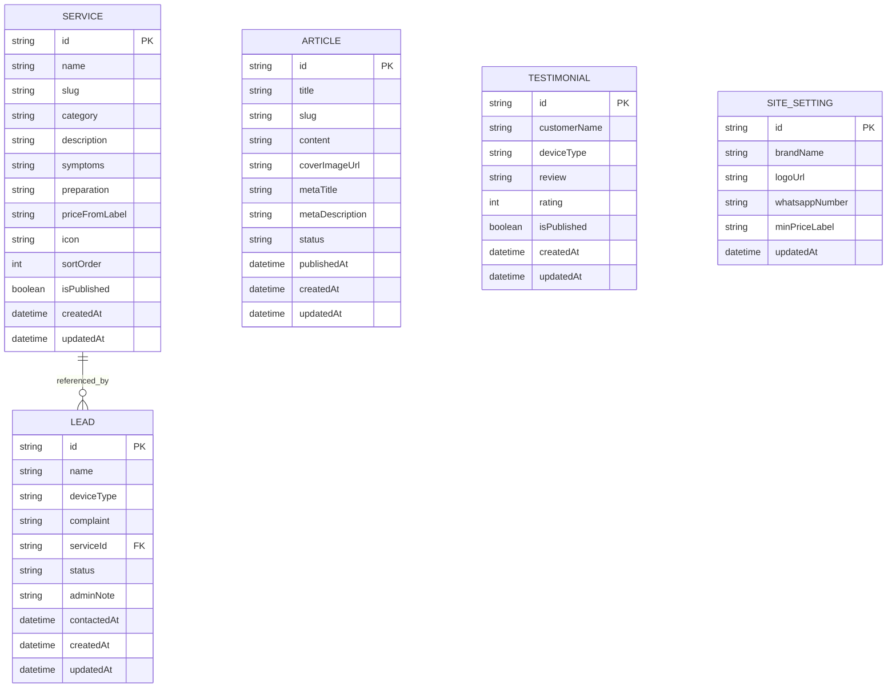

# DATABASE.md: TechFixSoftware

Dokumen ini mendefinisikan model data TechFixSoftware pada Neon Postgres dengan Prisma ORM v6. Cakupan tier ini dibatasi pada 5 tabel inti yang melayani FR-01 s.d. FR-17; tabel pendukung dicatat pada bagian "Not covered in this tier".

## 1. Prinsip Pemodelan

- Harga pasti tidak disimpan sebagai angka nominal transaksi; `Service.priceFromLabel` menyimpan teks tampilan "mulai dari Rp50.000" sesuai DEC-002.
- Lead disimpan sebelum redirect WhatsApp (NFR-05) sehingga `Lead` adalah entitas wajib, bukan opsional.
- Testimoni hanya dibuat oleh admin (DEC-005); tidak ada kolom sumber publik atau moderasi.
- Status lead memakai enum `LeadStatus` yang identik dengan FR-13: `NEW`, `CONTACTED`, `SCHEDULED`, `DONE`, `CANCELLED` (DEC-004).
- Kategori layanan disimpan sebagai `String` pada `Service` agar filter FR-09 tetap berjalan; normalisasi ke tabel `Category` ditunda (lihat §7).

## 2. ERD



Relasi lain bersifat implisit: `Article`, `Testimonial`, dan `SiteSetting` tidak memiliki foreign key ke tabel lain pada tier ini.

## 3. Definisi Tabel

### 3.1 Service

Menyimpan katalog layanan (FR-02, FR-03, FR-12).

| Column | Type | Constraints | Keterangan |
|:---|:---|:---|:---|
| id | String | PK, default cuid() | |
| name | String | NOT NULL | Nama layanan |
| slug | String | UNIQUE, NOT NULL | Dipakai pada URL detail (FR-03) |
| category | String | NOT NULL | Dasar filter FR-09 |
| description | String (Text) | NOT NULL | |
| symptoms | String[] | default [] | Gejala yang ditangani (FR-03) |
| preparation | String[] | default [] | Persiapan pelanggan, mis. bawa USB (DEC-001) |
| priceFromLabel | String | default "mulai dari Rp50.000" | DEC-002 |
| icon | String | NULL | Nama ikon `@tabler/icons-react` |
| sortOrder | Int | default 0 | Urutan tampil |
| isPublished | Boolean | default false | Hanya `true` tampil publik |
| createdAt / updatedAt | DateTime | NOT NULL | |

Index: `@@index([category, sortOrder])`, `@@index([isPublished])`.

### 3.2 Lead

Menyimpan hasil form konsultasi (FR-04, FR-13).

| Column | Type | Constraints | Keterangan |
|:---|:---|:---|:---|
| id | String | PK | |
| name | String | NOT NULL | Input pelanggan |
| phone | String | NULL di DB, wajib di form | Nomor WhatsApp, dinormalisasi ke format `62…`. Nullable hanya untuk baris lama sebelum form 4 field |
| deviceType | String | NOT NULL | Input pelanggan |
| complaint | String (Text) | NOT NULL | Input pelanggan |
| serviceId | String | FK → Service.id, NULL, onDelete SetNull | Konteks halaman layanan |
| status | LeadStatus | default NEW | FR-13 |
| adminNote | String (Text) | NULL | Catatan internal admin |
| agreedPrice | Int | NULL | Harga kesepakatan internal; tidak pernah dirender publik (DEC-002) |
| nextFollowUpAt | DateTime | NULL | Jadwal follow-up berikutnya; dipakai panel "Perlu ditindaklanjuti" |
| contactedAt | DateTime | NULL | Diisi saat status pertama kali menjadi CONTACTED (metrik PRD §7) |
| createdAt / updatedAt | DateTime | NOT NULL | |

Index: `@@index([status, createdAt])`, `@@index([nextFollowUpAt])`, `@@index([serviceId])`.

### 3.2.1 LeadActivity

Jejak aktivitas lead yang hanya bisa ditambah (append-only), dipakai untuk riwayat di panel admin.

| Column | Type | Constraints | Keterangan |
|:---|:---|:---|:---|
| id | String | PK | |
| leadId | String | FK → Lead.id, NOT NULL, onDelete Cascade | Riwayat ikut terhapus bersama lead |
| kind | LeadActivityKind | NOT NULL | `STATUS`, `NOTE`, `FOLLOW_UP`, `PRICE` |
| message | String (Text) | NOT NULL | Teks yang tampil di timeline |
| createdAt | DateTime | default now() | |

Index: `@@index([leadId, createdAt])`.

### 3.3 Article

Menyimpan artikel CMS (FR-06, FR-14). Konten disimpan sebagai String; format editor final TBD.

| Column | Type | Constraints | Keterangan |
|:---|:---|:---|:---|
| id | String | PK | |
| title | String | NOT NULL | |
| slug | String | UNIQUE, NOT NULL | URL stabil (NFR-06) |
| content | String (Text) | NOT NULL | |
| coverImageUrl | String | NULL | URL UploadThing (FR-16) |
| metaTitle | String | NULL | SEO |
| metaDescription | String | NULL | SEO |
| status | ContentStatus | default DRAFT | FR-14 |
| publishedAt | DateTime | NULL | Diisi saat dipublikasikan |
| createdAt / updatedAt | DateTime | NOT NULL | |

Index: `@@index([status, publishedAt])`.

### 3.4 Testimonial

Menyimpan testimoni yang diinput admin (FR-07, FR-15, DEC-005).

| Column | Type | Constraints | Keterangan |
|:---|:---|:---|:---|
| id | String | PK | |
| customerName | String | NOT NULL | |
| deviceType | String | NOT NULL | |
| review | String (Text) | NOT NULL | |
| rating | Int | NOT NULL, 1–5 | Validasi di Server Action |
| isPublished | Boolean | default false | |
| createdAt / updatedAt | DateTime | NOT NULL | |

Index: `@@index([isPublished, createdAt])`. Batas rating 1–5 ditegakkan di lapisan aplikasi (Prisma tidak punya CHECK native); tambahkan `CHECK` via migration manual bila diperlukan.

### 3.5 SiteSetting

Baris tunggal (singleton) berisi pengaturan situs (FR-05, FR-17).

| Column | Type | Constraints | Keterangan |
|:---|:---|:---|:---|
| id | String | PK, default "singleton" | Menjamin satu baris |
| brandName | String | default "TechFixSoftware" | |
| logoUrl | String | NULL | Logo milik pengguna |
| whatsappNumber | String | NULL | TBD — menunggu nomor resmi admin |
| minPriceLabel | String | default "mulai dari Rp50.000" | DEC-002 |
| updatedAt | DateTime | NOT NULL | |

## 4. Enum & Nilai Status

```prisma
enum LeadStatus {
  NEW
  CONTACTED
  SCHEDULED
  DONE
  CANCELLED
}

enum LeadActivityKind {
  STATUS
  NOTE
  FOLLOW_UP
  PRICE
}

enum ContentStatus {
  DRAFT
  PUBLISHED
}
```

`LeadStatus` konsisten dengan FR-13 dan DEC-004. `ContentStatus` melayani FR-14 (draft/publish artikel).

## 5. Prisma Schema

```prisma
generator client {
  provider = "prisma-client-js"
}

datasource db {
  provider = "postgresql"
  url      = env("DATABASE_URL") // Neon Postgres
}

enum LeadStatus {
  NEW
  CONTACTED
  SCHEDULED
  DONE
  CANCELLED
}

enum LeadActivityKind {
  STATUS
  NOTE
  FOLLOW_UP
  PRICE
}

enum ContentStatus {
  DRAFT
  PUBLISHED
}

model Service {
  id             String   @id @default(cuid())
  name           String
  slug           String   @unique
  category       String
  description    String
  symptoms       String[] @default([])
  preparation    String[] @default([])
  priceFromLabel String   @default("mulai dari Rp50.000")
  icon           String?
  sortOrder      Int      @default(0)
  isPublished    Boolean  @default(false)
  createdAt      DateTime @default(now())
  updatedAt      DateTime @updatedAt

  leads          Lead[]

  @@index([category, sortOrder])
  @@index([isPublished])
}

model Lead {
  id          String     @id @default(cuid())
  name        String
  // Nullable agar lead lama (sebelum form 4 field) tetap valid; form publik mewajibkan nomor.
  phone       String?
  deviceType  String
  complaint   String
  serviceId   String?
  service     Service?   @relation(fields: [serviceId], references: [id], onDelete: SetNull)
  status      LeadStatus @default(NEW)
  adminNote   String?
  agreedPrice Int?
  nextFollowUpAt DateTime?
  contactedAt DateTime?
  createdAt   DateTime   @default(now())
  updatedAt   DateTime   @updatedAt

  activities  LeadActivity[]

  @@index([status, createdAt])
  @@index([nextFollowUpAt])
  @@index([serviceId])
}

model LeadActivity {
  id        String           @id @default(cuid())
  leadId    String
  lead      Lead             @relation(fields: [leadId], references: [id], onDelete: Cascade)
  kind      LeadActivityKind
  message   String
  createdAt DateTime         @default(now())

  @@index([leadId, createdAt])
}

model Article {
  id              String        @id @default(cuid())
  title           String
  slug            String        @unique
  content         String
  coverImageUrl   String?
  metaTitle       String?
  metaDescription String?
  status          ContentStatus @default(DRAFT)
  publishedAt     DateTime?
  createdAt       DateTime      @default(now())
  updatedAt       DateTime      @updatedAt

  @@index([status, publishedAt])
}

model Testimonial {
  id           String   @id @default(cuid())
  customerName String
  deviceType   String
  review       String
  rating       Int
  isPublished  Boolean  @default(false)
  createdAt    DateTime @default(now())
  updatedAt    DateTime @updatedAt

  @@index([isPublished, createdAt])
}

model SiteSetting {
  id             String   @id @default("singleton")
  brandName      String   @default("TechFixSoftware")
  logoUrl        String?
  whatsappNumber String?
  minPriceLabel  String   @default("mulai dari Rp50.000")
  updatedAt      DateTime @updatedAt
}

// Tabel Better Auth (user, session, account, verification) dikelola oleh
// adapter Better Auth dan tidak dimodelkan manual pada tier ini.
```

Catatan: tidak ada partial unique index pada tier ini, sehingga tidak diperlukan raw SQL tambahan.

## 6. Catatan Implementasi

- Migrasi dijalankan dengan `prisma migrate dev` (lokal) dan `prisma migrate deploy` (Vercel build) terhadap `DATABASE_URL` Neon.
- Query publik wajib memfilter `isPublished = true` (Service, Testimonial) dan `status = PUBLISHED` (Article) agar draft tidak bocor.
- Penulisan `Lead` dilakukan di Server Action sebelum membangun URL `wa.me`; kegagalan insert mengembalikan error dan tidak melakukan redirect (NFR-05).
- `SiteSetting` dibaca di setiap CTA WhatsApp (FR-05); jika `whatsappNumber` masih `NULL`, tombol harus dinonaktifkan — nilai final TBD.

## 7. Not covered in this tier

| Item | Alasan / Rencana |
|:---|:---|
| Tabel `User`, `Session`, `Account`, `Verification` | Dikelola otomatis oleh Better Auth (FR-10); skema mengikuti adapter resmi |
| Tabel `Category` | FR-09 dilayani `Service.category` sebagai String; normalisasi ditunda |
| Tabel `Media` | FR-16 memakai URL UploadThing yang disimpan langsung di `Article.coverImageUrl`, `Service` (thumbnail), dan `SiteSetting.logoUrl` |
| Tabel `ArticleTag` / relasi tag | Tidak diminta FR manapun |
| Log percobaan rate limit (NFR-07) | Mekanisme dan penyimpanan TBD |
| Format konten artikel (rich text/JSON) | TBD — menunggu keputusan editor admin |