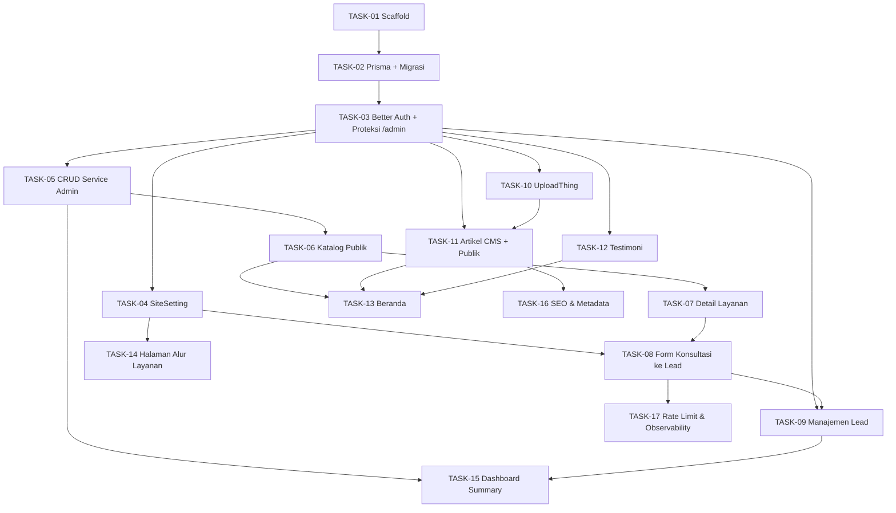

# TASKS.md: TechFixSoftware

Backlog implementasi ini memecah spesifikasi TechFixSoftware menjadi slice end-to-end yang dapat diverifikasi. Skema data merujuk ke DATABASE.md, kontrak endpoint ke API.md, dan perilaku fitur ke FEATURES.md; dokumen ini tidak mengulang definisi tabel maupun payload. Setiap tugas memakai ID `FR-XX`/`DEC-XXX` persis dari sumbernya. Status seluruh tugas di dokumen ini adalah **belum dikerjakan**.

## 1. Konvensi Penulisan Tugas

- Satu tugas = satu slice yang terlihat pengguna atau membuka jalan langsung ke slice berikutnya.
- Kolom **Blocked by** bersifat keras: tugas tidak dimulai sebelum prasyaratnya lulus acceptance check.
- Verifikasi memakai metode yang dapat diulang (build, request `curl`, inspeksi baris database, uji manual e2e).
- Nilai yang belum diputuskan ditandai `TBD` dan tugasnya ditandai **BLOCKED** pada §4 — tidak ada nominal, ambang, atau teks pesan yang dikarang.

## 2. Urutan Dependensi

## 3. Backlog Tugas

### Fase 0 — Fondasi

| ID | Objective | FR | DEC | Blocked by | Acceptance check | Verifikasi |
|:---|:---|:---|:---|:---|:---|:---|
| TASK-01 | Scaffold Next.js 15 (App Router) + React 19 + TypeScript, Tailwind CSS v4, shadcn/ui, `@tabler/icons-react`, Prisma ORM v6 terhubung ke Neon | FR-01 s.d. FR-17 (fondasi) | — | — | `npm run build` sukses; `package.json` tidak memuat `lucide-react`; satu ikon Tabler terender di halaman contoh | Build CI lokal + inspeksi `package.json` |
| TASK-02 | Definisikan model `Service`, `Lead`, `Article`, `Testimonial`, `SiteSetting`, enum `LeadStatus` dan `ContentStatus`, index, lalu migrasi ke Neon | FR-12, FR-13, FR-14, FR-15, FR-17 | DEC-002, DEC-004, DEC-005 | TASK-01 | Migrasi sukses; lima tabel + dua enum ada; `Service.slug` UNIQUE; `Lead.status` default `NEW` | `npx prisma migrate status` + query `information_schema` |
| TASK-03 | Pasang Better Auth dengan adapter Prisma/Neon, halaman login admin, dan guard pada seluruh route `/admin` | FR-10 | — | TASK-02 | Akses `/admin` tanpa sesi dialihkan ke login; sesi valid membuka dashboard; registrasi publik tidak tersedia | Uji manual e2e + `auth.api.getSession({ headers })` pada Route Handler |

### Fase 1 — Pengaturan Situs & Layanan Admin

| ID | Objective | FR | DEC | Blocked by | Acceptance check | Verifikasi |
|:---|:---|:---|:---|:---|:---|:---|
| TASK-04 | Form pengaturan situs singleton (`brandName`, `logoUrl`, `whatsappNumber`, `minPriceLabel`) dengan Server Action | FR-17, FR-05 | DEC-002 | TASK-02, TASK-03 | Hanya satu baris `SiteSetting` (`id = "singleton"`); `minPriceLabel` default `mulai dari Rp50.000`; `whatsappNumber` kosong disimpan sebagai `NULL`, bukan string kosong | Submit form + `SELECT * FROM "SiteSetting"` |
| TASK-05 | CRUD layanan admin: nama, slug, kategori, deskripsi, `symptoms`, `preparation`, `priceFromLabel`, ikon Tabler, `sortOrder`, `isPublished` | FR-12 | DEC-002 | TASK-02, TASK-03 | `isPublished` default `false`; slug duplikat ditolak `VALIDATION_ERROR`; tidak ada field harga numerik pada form maupun tabel | Uji CRUD di dashboard + query tabel `Service` |

### Fase 2 — Katalog Publik

| ID | Objective | FR | DEC | Blocked by | Acceptance check | Verifikasi |
|:---|:---|:---|:---|:---|:---|:---|
| TASK-06 | Implementasi `GET /api/v1/services` dan halaman katalog dengan filter kategori yang tercermin di query string | FR-02, FR-09 | DEC-002 | TASK-05 | Hanya `isPublished = true` yang tampil; urutan `sortOrder` menaik; filter `?category=` mempersempit hasil; tidak ada nominal harga di respons maupun DOM | `curl /api/v1/services?category=Software` + inspeksi DOM |
| TASK-07 | Implementasi `GET /api/v1/services/{slug}` dan halaman detail layanan (deskripsi, gejala, persiapan, CTA konsultasi) | FR-03 | DEC-001, DEC-002 | TASK-06 | Layanan tidak terbit menghasilkan `404 NOT_FOUND`; `preparation` memuat persiapan device (mis. bawa USB); satu-satunya penanda harga adalah `priceFromLabel` | `curl` slug terbit dan tidak terbit + uji render 360px |

### Fase 3 — Funnel Lead

| ID | Objective | FR | DEC | Blocked by | Acceptance check | Verifikasi |
|:---|:---|:---|:---|:---|:---|:---|
| TASK-08 | Implementasi `POST /api/v1/leads` + form konsultasi singkat yang menyimpan lead lalu mengarahkan ke `wa.me` | FR-04, FR-05, NFR-05 | DEC-003 | TASK-04, TASK-07 | Baris `Lead` dengan `status = NEW` tersimpan **sebelum** redirect; insert gagal → tidak ada redirect dan error ditampilkan; `whatsappNumber` `NULL` → `503 WHATSAPP_NOT_CONFIGURED` dan lead tidak dibuat; field kosong → `422` dengan `details` per field | Submit form e2e + `SELECT * FROM "Lead"` + `curl` kasus 503 dan 422 |
| TASK-09 | Daftar lead admin dengan filter status, panel detail, `PATCH /api/v1/admin/leads/{id}` untuk `status` dan `adminNote` | FR-13 | DEC-004 | TASK-03, TASK-08 | Lima status `NEW`/`CONTACTED`/`SCHEDULED`/`DONE`/`CANCELLED` dapat dipilih; `contactedAt` terisi hanya pada transisi pertama ke `CONTACTED`; endpoint tanpa sesi → `401` | Uji transisi status + query `Lead.contactedAt` |

### Fase 4 — Konten

| ID | Objective | FR | DEC | Blocked by | Acceptance check | Verifikasi |
|:---|:---|:---|:---|:---|:---|:---|
| TASK-10 | Integrasi UploadThing untuk cover artikel, thumbnail layanan, dan logo brand; URL disimpan pada field terkait | FR-16 | — | TASK-03 | Upload sukses mengembalikan URL yang tersimpan di `Article.coverImageUrl` atau `SiteSetting.logoUrl`; unggahan gagal tidak menimpa nilai lama | Upload manual + query field tujuan |
| TASK-11 | CMS artikel (draft → published, `metaTitle`, `metaDescription`) dan halaman publik daftar + detail artikel | FR-06, FR-14 | — | TASK-03, TASK-10 | Hanya `status = PUBLISHED` tampil publik; `publishedAt` terisi saat publikasi; slug unik; draft → `404` di publik | Uji draft/publish + `curl /api/v1/articles` dan `/api/v1/articles/{slug}` |
| TASK-12 | CRUD testimoni admin (nama, device, ulasan, rating 1–5, `isPublished`) dan halaman testimoni publik read-only | FR-07, FR-15 | DEC-005 | TASK-03 | Rating di luar 1–5 ditolak di Server Action; tidak ada form maupun endpoint testimoni publik; hanya `isPublished = true` tampil | Uji input rating `0` dan `6` + inspeksi route publik |

### Fase 5 — Halaman, Ringkasan, dan Operasional

| ID | Objective | FR | DEC | Blocked by | Acceptance check | Verifikasi |
|:---|:---|:---|:---|:---|:---|:---|
| TASK-13 | Beranda: hero brand dengan logo pengguna, layanan unggulan, testimoni terpilih, artikel terbaru, CTA konsultasi | FR-01 | — | TASK-06, TASK-11, TASK-12 | Keempat blok terisi dari data nyata; tidak ada testimoni atau statistik fiktif; layout berfungsi 360px–1440px | Uji render + audit konten manual |
| TASK-14 | Halaman alur layanan dengan empat tahap berurutan dan penegasan harga final via konsultasi | FR-08 | DEC-002 | TASK-04 | Empat tahap tampil berurutan, terbaca pada 360px, tanpa nominal harga pasti | Uji render mobile/desktop |
| TASK-15 | Ringkasan dashboard: jumlah lead `NEW`, layanan aktif, artikel, testimoni | FR-11 | — | TASK-05, TASK-09, TASK-11, TASK-12 | Angka cocok dengan `COUNT` tabel sumber pada saat halaman dimuat | Bandingkan UI dengan query `COUNT` |
| TASK-16 | Metadata per halaman, sitemap, dan slug stabil untuk katalog, detail layanan, artikel, dan halaman statis | NFR-06 | — | TASK-06, TASK-07, TASK-11 | Setiap halaman publik punya `title` dan `description`; sitemap memuat URL terbit saja | Inspeksi `` + buka `/sitemap.xml` |
| TASK-17 | Rate limit pengiriman form konsultasi dan pencatatan error server/kegagalan upload | NFR-07, NFR-08 | — | TASK-08 | Permintaan melebihi ambang menerima `429 RATE_LIMITED`; error server tercatat tanpa membocorkan detail ke pengguna | Uji beban berulang + inspeksi log — **BLOCKED**, lihat §4 |

## 4. Tugas BLOCKED (Menunggu Keputusan)

| ID | Keputusan yang dibutuhkan | Dampak bila ditunda |
|:---|:---|:---|
| TASK-04 | Nomor WhatsApp resmi admin (`SiteSetting.whatsappNumber`) | CTA WhatsApp tetap nonaktif; hanya struktur form yang dapat diuji |
| TASK-08 | Format pesan prateks WhatsApp (isi, urutan, salam) | Redirect berjalan, tetapi teks pesan belum final |
| TASK-17 | Ambang dan mekanisme rate limit (NFR-07) serta tujuan penyimpanan log error (NFR-08) | Endpoint `/api/v1/leads` belum terlindungi dari penyalahgunaan |
| TASK-05 | Daftar final kategori layanan dan teks tiap layanan | Seeding katalog hanya memakai data contoh sementara |

## 5. Definition of Done dan Pemeriksaan Lintas Tugas

Sebuah tugas dianggap lulus bila: build TypeScript tanpa error, validasi server-side berjalan pada setiap Server Action/Route Handler (NFR-04), tidak ada elemen yang menampilkan nominal harga pasti (DEC-002), ikon berasal dari `@tabler/icons-react`, dan label/atribut form memenuhi WCAG 2.1 AA (NFR-03). Target performa (NFR-01), target responsivitas terukur (NFR-02), serta seluruh KPI pada PRD §7 tetap `TBD` dan tidak boleh diisi sebagai kriteria lulus.

<!-- SDD_SOURCE_DOCS: api,database,decisions,design,features,prd -->
